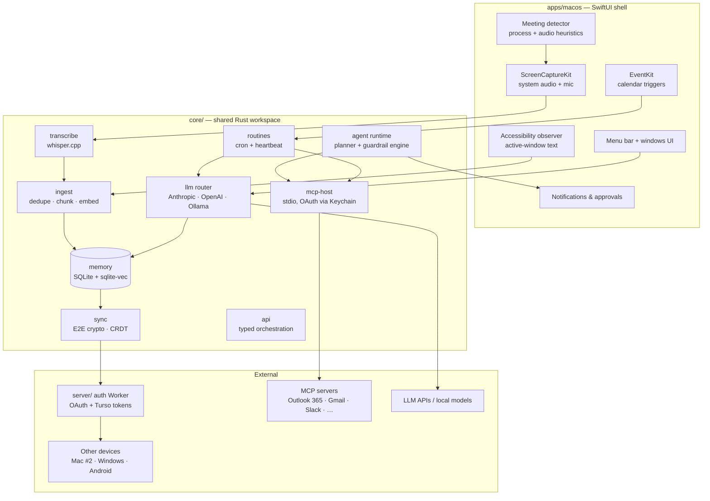

# 04 — Architecture

## Overview

A native SwiftUI shell owns everything platform-specific (capture, permissions, UI); a shared Rust core owns everything portable (storage, intelligence, sync, agency). The core is the asset that carries to Windows and Android.

## Components

### apps/macos — Swift/SwiftUI shell
- **Menu-bar app** (LSUIElement) with capture-state indicator, pause control, and windows for timeline, search, chat, meetings, routines, and settings.
- **Capture services** (native, feeding core over FFI/IPC):
  - Accessibility observer: `AXObserver` on focused app/window, text extraction, OCR fallback via Vision.
  - Audio: ScreenCaptureKit stream (system audio) + AVAudioEngine (mic); Core Audio process taps where available.
  - Calendar: EventKit polling + change notifications → trigger events into the routine engine.
  - Meeting detector: NSWorkspace running-app observation + CoreAudio device-in-use checks.
- **Approval surfaces**: notification-based and in-app approval prompts for agent/routine write actions.
- Launch agent for the capture daemon; app and daemon communicate over XPC.
- **What the shell no longer owns (M3.0, 2026-09):** transcript post-processing, retention and orphan sweeps, model download, update-manifest and hash checks, starter prompts and urgency, hosted model lists, meeting-workspace state, routine write-action plan/settle, connector sync iterations and the connected-account registry, OAuth (PKCE, loopback listener, exchange, refresh), the sync Worker client and enrollment decisions, and the settings-sync iteration rules all live in `core/api` and are called through `CoreBridge.swift`. Swift keeps timers, Keychain/UserDefaults access, `ASWebAuthenticationSession`, the MCP HTTP calls, and UI (`docs/12-windows-app-design.md` §5 has the per-item table).

### core — Rust workspace (crate per subsystem)
- **ingest**: normalization, simhash dedupe, chunking, local embedding (e.g., a small embedding model via candle/ONNX).
- **memory**: SQLite (WAL) + sqlite-vec for vectors; FTS5 for keyword; retention/deletion engine; timeline queries.
- **transcribe**: whisper.cpp bindings, streaming transcription, channel diarization; language auto-detect.
- **llm**: provider-agnostic router (Anthropic, OpenAI, Ollama) with per-query policy (sensitivity, cost tier), prompt assembly with retrieval, and the "what left my machine" ledger.
- **agent**: plan/act loop over a `ComputerDriver` trait (implemented natively per OS), guardrail engine enforcing skill manifests and approval gates, audit log.
- **mcp-host**: MCP client (stdio transport; remote/HTTP transport deferred). Implements `connect`/`list_tools`/`call_tool`/`disconnect` over the official `rmcp` SDK. One real connector included: `mcp-servers/google-calendar/` (read-only calendar list/event queries). OAuth handled by `core/api::oauth` (PKCE, loopback listener, exchange, refresh) with `GoogleOAuthHelper.swift` keeping only the Keychain storage and browser session (M3.0). Per-tool permission scopes not yet exposed to native UI (write actions gated by FR-AGT-2 approval gates). Each layer is covered in isolation, not composed: `core/mcp-host`/`core/ffi` against a generic fixture MCP server (not OAuth or the real Calendar connector), `mcp-servers/google-calendar/` against a mocked Google response, and the OAuth loopback listener against the real compiled `GoogleOAuthHelper.swift`/`LoopbackListener` source, confirming it binds `127.0.0.1`-only, rejects a mismatched-`state` redirect, and returns the authorization code on a matching one (verified during Task 4's fix-round review, not a separate reproduction) — though still not a real interactive consent flow with Google. The full composed path — real Google OAuth consent through to real Calendar data returned via the spawned connector — has never been exercised and needs a human with real Google Cloud OAuth credentials to verify. Credentials are passed to a spawned connector via its process environment at spawn time (e.g. `GOOGLE_CALENDAR_ACCESS_TOKEN`) — readable by other processes running as the same user, an accepted tradeoff for a read-only scope with this connector but worth reconsidering (e.g. a stdin-delivered credential instead) if a future connector needs a higher-value scope. Deferred scope: rest of FR-MCP-2's connector catalog, FR-MCP-4's arbitrary-server registration UI, FR-MCP-5's health dashboard, remote HTTP transport, native UI for permission grants.
- **routines**: cron scheduler, heartbeat ticks, routine definition model (trigger → steps → delivery), run history.
- **sync**: per-device X25519 keypairs, a group symmetric key for the user's device set, HKDF+ChaCha20Poly1305 key-wrapping to hand the group key to a newly-approved device, and ChaCha20Poly1305 payload encryption/decryption — all implemented as of `docs/superpowers/plans/2026-07-29-sync-crypto-core.md`. Native enrollment UI (Google Sign-In via loopback OAuth with `openid email` scope using a dedicated `GoogleOAuthHelper` instance, a waiting screen, and a Devices settings panel with approve support) calls the Worker routes and `core/ffi` crypto bindings, per `docs/superpowers/plans/2026-07-30-sync-device-enrollment-ui.md`. Settings sync (routing/retention/capture-exclusion settings, and opt-in API keys) is implemented via a new `core/sync-engine` crate — field-level last-writer-wins merge against a `settings_field` Turso table — per `docs/superpowers/plans/2026-07-30-sync-settings-data-layer.md`. Content sync (meetings/transcripts/captures) is still a separate, later plan. Still to come: CRDT (automerge-style) for mutable objects, the append-only encrypted log's actual storage/transport (Turso, per `docs/superpowers/specs/2026-07-29-multi-device-sync-accounts-design.md`), and the relay client. **Deployed and verified live as of 2026-07-30**: the Worker (`kestrel-sync-worker.mpointer.workers.dev`) and a Turso control-plane database are both real and running; device enrollment and settings sync have been confirmed working end-to-end across two physical Macs, including cross-device approval and settings propagation. One real bug was caught only by this live verification and is now fixed: `core/sync-engine`'s `libsql` dependency had its `tls` feature accidentally dropped by an earlier fix that slimmed unrelated default features, which crashed the app on launch the moment it tried a real (non-local-file) Turso connection — every prior automated test used local-file mode, so nothing caught it before a real deploy existed. Device `name`/`platform` are still always `nil` in the UI, as no server-side write path exists yet for them.
- **api**: typed orchestration over the crates above (M3.0, `docs/superpowers/plans/2026-09-07-core-api-split.md`): `&memory::Store` in, `Result<T, ApiError>` out, every `T` a serde type whose field names are the JSON the shells already decode. Modules: `ask` (grounded chat, prepare/finalize streaming split), `summary` (governed meeting summary), `digest`, `spend`, `routine_runs` (scheduler tick), `inference` (streaming run registry, ADR 0002), `jobs` (episode/thread summarize batches), `sync_ops` (hidden-episode settings-sync fields), `mcp` (client tokens), plus `routing`/`envelope`/`util`. Depends only on portable crates — never `transcribe`/`diarize`, never libsql's `core` feature. ADR 0001's rule holds: nothing here holds a lock while it calls a provider; the *caller* serializes `Store` access — a dispatch queue on macOS today, and on Windows the `store_actor` task described in `12-windows-app-design.md` §3, which is the `ProfileEngine` shape ADR 0001 deferred. Functions that are one `Store` call with no shaping have no `api` twin; a Rust shell calls `Store` directly, as `ffi` does.
- **ffi**: C language bindings exposing core's functionality to native shells — now a thin adapter over `api` for everything orchestration-shaped (parse C strings → call `api` → envelope → C string), and a direct `Store`/`transcribe`/`diarize`/`sync`/`mcp-host` pass-through for the rest. Follows a JSON-in/JSON-out-over-C-ABI convention. Includes the new `littlebird_sync_*` family of functions exposing `core/sync`'s crypto primitives: device keypair generation and re-derivation, group key generation, group key wrap/unwrap, and payload encrypt/decrypt. Each C function has a matching Swift wrapper (static func) in `CoreBridge.swift` for convenient use from the macOS app. (The sync crypto functions are now called by the native enrollment UI per `docs/superpowers/plans/2026-07-30-sync-device-enrollment-ui.md`.)

### server — auth Worker
Cloudflare Worker (`server/`): verifies Google ID tokens against a fail-closed sign-in allowlist, maintains a control-plane account/device registry, provisions one isolated Turso database per account, and mints device tokens scoped to only that account's database via `POST /v1/auth/google` — implemented as of `docs/superpowers/plans/2026-07-29-sync-auth-worker.md` and `docs/superpowers/plans/2026-07-29-sync-worker-account-isolation.md`. The wrapped-group-key handoff is now wired in: `POST /v1/devices` lists an account's devices, `POST /v1/devices/:id/approve` lets an already-approved device push a wrapped group key to a pending one, and `POST /v1/auth/google` returns that wrapped key to the pending device on its next poll — implemented as of `docs/superpowers/plans/2026-07-29-device-enrollment-worker-routes.md`. (`core/ffi`'s crypto bindings for `wrap_group_key`/`unwrap_group_key` are implemented per `docs/superpowers/plans/2026-07-29-core-ffi-sync-crypto-bindings.md`, and native-side enrollment UI calls them per `docs/superpowers/plans/2026-07-30-sync-device-enrollment-ui.md`.) **Deployed 2026-07-30** to `kestrel-sync-worker.mpointer.workers.dev`, with a `whimbrel-sync-control` Turso database (control-plane `account`/`device` tables applied) in the org's `default` group; the full path — Google sign-in, device approval, and settings sync — has been verified live end-to-end across two physical Macs. Never holds plaintext or the group key in the clear. Not a data-plane component: sync payload data goes straight from a device to its account's Turso database. Concrete design: `docs/superpowers/specs/2026-07-29-multi-device-sync-accounts-design.md`.

## Data model (core tables, simplified)

| Table | Key fields |
|---|---|
| `capture_item` | id, device_id, ts, app_bundle_id, window_title, url, text, embedding, hash, source (ax/ocr, nullable) |
| `meeting` | id, device_id, start/end ts, title, attendees, trigger (calendar/detected), audio_path, status |
| `transcript_segment` | id, meeting_id, start_cs, speaker_label, text, embedding — implemented (FR-CHAT-1 follow-on); no `channel` column (redundant with `speaker_label` — "Me" is always mic, anything else is always system), `start_cs` centiseconds not a separate `ts` (matches `transcribe`/`diarize`'s existing convention); `embedding` lives in a paired `transcript_segment_vec` virtual table, matching `capture_item`'s pattern, not a literal column |
| `summary` | source (meeting/day/week), source_id, kind, content_md |
| `skill` | id, manifest (perms, triggers), body_md, enabled |
| `routine` | id, schedule/heartbeat condition, steps, delivery, enabled |
| `run_log` | routine/skill id, ts, status, output ref |
| `agent_audit` | ts, skill_id, action, target, approval, evidence ref |
| `device` | id, pubkey, name, platform, enrolled_at, revoked_at |

## LLM strategy

- **Always local**: embeddings, transcription.
- **Routable**: chat/summarization/synthesis — hosted frontier models by default, local models for sensitive-data mode or offline; per-query routing policy owned by the user.
- Summarization is batched (end of meeting, end of day) to control cost; ambient capture itself never triggers per-event LLM calls.

## Key platform decisions

1. **Swift native shell, not Electron/Tauri** — capture quality and TCC UX are the product; native APIs are unavoidable, and the UI is thin relative to the core.
2. **Rust core behind FFI** — one implementation of the hard 80% (memory, sync, agent, MCP) across all future platforms (NFR-PRT-1).
3. **Text-first capture** — Accessibility text instead of screenshots keeps storage tiny, search high-quality, and the privacy story defensible; OCR only as fallback.
4. **SQLite everywhere** — one file per user, trivially encrypted, portable to mobile.
5. **MCP as the only integration mechanism** — first-party connectors are just well-configured MCP servers, so third-party extension is free.
6. **Approval-gated agency** — the agent is untrusted by default; trust is granted per skill, per action class (FR-AGT-2), mirroring Hermes' guardrail layering.
