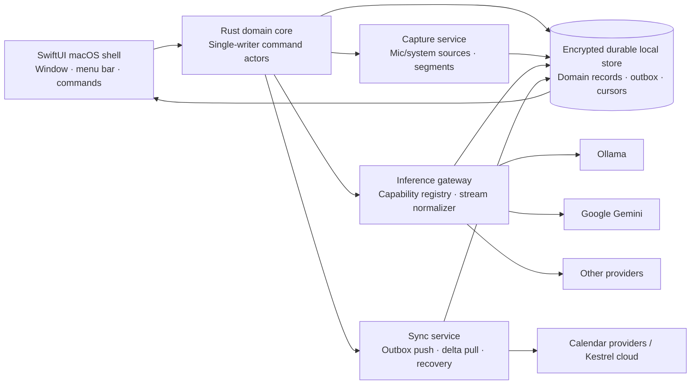

# Kestrel macOS Evaluation and Resolution Plan

**Prepared by:** Manus AI  
**Date:** August 27, 2026  
**Scope:** Existing Rust/Swift **macOS** application only; mobile, web, and Windows are deliberately out of scope.

## Executive assessment

Kestrel has the ingredients for a differentiated meeting-and-work-memory application, but the current reported behavior falls below the trust threshold for a tool that captures high-value conversations. **Intermittent synchronization failures, unclear recording boundaries, non-streamed/non-cancellable inference, and model-driven layout overlap are connected system failures.** Together, they make the user doubt whether Kestrel is listening, saving, processing, or safe to use.

The immediate mandate is not to add more models or more visual surfaces. It is to make Kestrel **locally reliable, visibly controllable, provider-neutral, and spatially calm**. Granola supplies the benchmark for intentional capture, persistent recording visibility, stop/resume, transcript access, and calendar-linked workflow. [1] [2] Littlebird supplies the benchmark for context-aware meeting preparation, cross-work recall, and a clear data-control posture. [3] [4] Kestrel can surpass both by combining those capabilities with local-first durability, per-meeting data-routing policy, source-cited recall, and a stronger recording-boundary model.

> **North-star experience:** Kestrel is a calm meeting cockpit. In less than one second, a user can tell whether Kestrel is recording, which audio sources are healthy, what meeting is active, where their data is going, what work is in progress, and how to stop it.

## Evidence boundary

The evaluation is fresh but necessarily constrained. The selected GitHub repository was `futuremeanswered/CareerPointers`; it does **not** contain the Kestrel Rust/Swift macOS source, and no Kestrel folder was bound. Therefore the current-state issues below are classified as **reported** where they come from the request; recommendations are target-state requirements rather than assertions that a particular current class, schema, or service is absent.

| Evidence ID | Current observation | Confidence | Assessment consequence |
|---|---|---:|---|
| R-01 | Synchronization failures are intermittent | High | A reliable local write path, replay-safe replication, and visible recovery are urgent |
| R-02 | UI space is poorly used | High | The primary meeting workspace needs a hierarchy and density redesign |
| R-03 | UI overlaps after Google models were added | High | Provider configuration currently affects layout unsafely; this is a functional regression |
| R-04 | LLM inference cannot stream or be stopped | High | User agency and app responsiveness are broken during inference |
| R-05 | Ollama may be especially slow | High | Local-model lifecycle/progress/cancellation requires a dedicated interaction path |
| U-01 | Current schema, queues, conflict strategy, audio implementation, and Swift/Rust concurrency boundary | Unknown | Validate before implementation; do not infer source-level defects from symptoms |

## Competitive benchmark

Granola describes an intentionally started local desktop capture flow: users start from a notification, an opened calendar-linked note, or a New Note; while active they see an in-note indicator and a repositionable floating meeting indicator. Its transcript panel supports show/hide, Stop/Resume, search, copy, and chunk deletion. It documents the limitations of automatic stop—such as back-to-back calls and macOS administrative rights—and makes manual Stop the reliable override. [1]

Littlebird describes bot-free computer-audio meeting notes with calendar-linked automatic transcription, an in-meeting assistant, pre-meeting preparation from email, prior meetings, and relevant projects, plus later contextual recall. [3] Its privacy policy articulates a broader work-memory data posture, including user access/deletion choices, encryption claims, opt-outs, and a statement that data is not used to train models. [4]

| Capability | Granola reference point | Littlebird reference point | Kestrel functional gap from reported state | Kestrel resolution that surpasses both |
|---|---|---|---|---|
| Recording control | Deliberate start; visible active state; Stop/Resume; manual stop is authoritative | Calendar-linked, bot-free workflow | Start/stop boundary and visibility must be proven reliable | A persisted recording state machine; one Stop command in note, menu bar, and keyboard shortcut; source-health indicators; **Buffer & Confirm** between likely meetings |
| Live transcript | Inspectable live panel with search and transcript edits | Automatic capture and summary | No verified Kestrel live-work contract | Transcript inspector independent of notes and AI; source/time anchors; never steals editing focus |
| AI work | Note enhancement/chat in meeting context | In-meeting questions and contextual recall | Long-running work is blocking and opaque | Universal streaming/cancel state; source-grounded response; partial-result control; local-model warm-up state |
| Calendar/context | Calendar selection, upcoming list, related meetings | Prep across email, past meetings, and projects | Sync unreliability compromises context | Separate calendar connector health from Kestrel-data replication; cited brief; duplicate/recurrence visibility |
| Work memory | Meeting-focused history | Cross-app connected memory | Potentially isolated summaries rather than durable recall | Local full-text first; opt-in semantic index; cited answers that jump to source transcript/note ranges |
| Data/trust | Audio not saved according to published docs | Broad memory with stated controls | Policy/routing state not verified | Per-meeting Local Only / approved cloud policy, egress indicator, provenance, retention and deletion verification |
| Desktop UX | Bounded home view and persistent live-state cues | Simple Mac meeting surface | Waste and overlap signal weak hierarchy | Stable app shell; primary note canvas; optional inspector; model capability picker that never expands the toolbar |

## Root diagnosis

The symptoms are best treated as architectural coupling rather than separate defects. A fixed control row breaks when models are added because **provider configuration has escaped into layout**. A frozen inference view occurs because **provider work has escaped into interaction state**. Sync becomes intermittent when **local actions and remote replication are not durably separated and replay-safe**. Ambiguous recording lifecycle occurs when **audio capture and downstream finalization are represented as one Boolean or one blocking task**.

Kestrel should be designed as a **local-first evented macOS application**. A user action is committed locally and immediately projected to SwiftUI. Background services synchronize data, call models, and process capture independently. Network outages, provider stalls, and calendar errors must never disable the local editor or make a completed Stop action appear uncertain.



### Rust/Swift responsibility boundary

| Layer | Owns | Must not own |
|---|---|---|
| Rust domain core | Stable IDs, domain state machines, database transactions, outbox, connector cursors, inference run state, cancellation tokens, policy checks, telemetry events | View layout, SwiftUI state mutation, per-view direct network calls |
| Provider/capture adapters | Protocol translation, source/device health, stream parser, transport closure, provider-specific recovery | Canonical note semantics or user-interface decisions |
| SwiftUI shell | Rendering immutable projections, accessibility, focus, keyboard commands, resizable panels, user intent dispatch | Business-state mutation, independent retry loops, a parallel model-specific state machine |
| Shared event bridge | Typed projections/events from Rust to Swift, appropriately bounded buffer, main-actor delivery | Unbounded raw transcript/inference updates that overload layout or move focus |

## Data and data-architecture resolution

Kestrel must preserve the distinction between **immutable source facts**, **user-authored work**, **derived AI artifacts**, and **replication control data**. An AI summary is not the meeting’s canonical record; it is a replaceable result derived from known input. A transcript segment, calendar snapshot, and capture boundary should each retain provenance that permits retrieval, regeneration, deletion, and sync recovery.

| Data class | Canonical entity | Required provenance/version | Resolution |
|---|---|---|---|
| Calendar event | `calendar_event_snapshot` | Account, calendar, provider event ID, iCalUID/recurrence metadata, ETag/version, fetched time | Treat provider calendar as source of truth; do not synthesize a competing calendar object |
| Meeting | `meeting_session` | Stable UUID/ULID, optional calendar foreign key, explicit lifecycle revision, human title history | Create locally before any network acknowledgment; retain clear session identity across restart |
| Capture/transcript | `capture_segment`, `transcript_segment` | Session, sequence, time/sample range, mic/system source, content hash, accuracy/diarization metadata | Append-only segments; raw-audio retention policy is explicit, not accidental |
| Notes | `note_document`, `note_operation` | Document ID, actor/device ID, hybrid logical clock or operation ID, content revision | Use CRDT for truly concurrent rich-text editing; otherwise field-level optimistic revisions with visible conflict resolution |
| AI output | `artifact`, `inference_run` | Input snapshot hash, prompt/template version, provider/model, policy mode, terminal state | Derived and regenerable; never silently overwrite a user edit |
| Replication | `sync_operation`, `sync_cursor`, `sync_error` | Operation ID/idempotency key, aggregate revision, connector cursor, retry class, trace ID | Durable outbox/inbox; delete only after acknowledged durable processing |

The key invariant is transactional: **a local domain mutation and its outbox operation commit together.** Pressing Stop, for example, must persist the capture boundary and session state, enqueue the durable change, and update the local projection in one transaction. If Kestrel crashes before sync, recovery is automatic on relaunch. This removes the dangerous gap between “the UI said it saved” and “the background request was never sent.”

### Required privacy and governance stance

Kestrel should make the data route visible at the moment of capture and inference. A meeting can have a policy such as **Local Only**, **Approved Cloud**, or **Ask Every Time**, with enterprise policy able to narrow—not silently broaden—the choice. A Local Only policy must deny external model dispatch at the Rust-core policy boundary rather than merely hiding cloud models in the UI. The app should provide source-scoped export, deletion, retention, and a PII-redacted diagnostic package. Littlebird’s public data-control posture shows that a serious work-memory product must make user agency explicit. [4]

## Sync architecture and operational recovery

There are two different synchronization problems that should never share an opaque “Syncing” spinner: **calendar/provider synchronization** and **Kestrel’s own replication of meetings, transcripts, notes, and artifacts**. Each needs its own cursor, queue, retry classification, and user-facing status.

| Concern | Required engineering pattern | User experience | Release criterion |
|---|---|---|---|
| Local mutations | Single transaction: domain write + outbox event | New note/meeting is immediately usable offline | Force-quit after every primary mutation; no acknowledged action is lost after relaunch |
| Push replication | Bounded batches, stable idempotency keys, exponential backoff with full jitter | Silent while recovering; actionable only when intervention is needed | Replaying a batch at least 10 times creates no duplicate meeting, segment, task, or deletion |
| Pull replication | Cursor/watermark committed only with received changes; full-resync fallback | “Updated” identifies the source, not a vague global state | Crash during pull cannot skip an inbound remote update |
| Calendar connector | Provider sync token/ETag, recurrence-aware identity, account/calendar partitioning | Named account health, last success, and reconnect action | Expired cursor/full resync never generates duplicate meeting cards |
| Conflicts | Text CRDT or operation log; deterministic field-level rules for metadata | Preserve both human contributions; ask only for real semantic conflict | Simultaneous offline note edits converge without character loss |
| Error taxonomy | Persisted credential, offline, rate limit, provider 5xx, schema, and permanent-policy errors | Clear “Reconnect Google,” “Retry now,” or “Saved on this Mac” action | Errors are distinguishable without reading a raw trace |
| Diagnostics | Correlation ID from local mutation to remote acknowledgment; redacted export | Support panel is on demand, not permanent interface chrome | A support engineer can identify the failure class from exported diagnostics without capturing meeting content |

Granola’s public calendar experience sets a useful minimum: a bounded upcoming-meetings view, configurable calendars, propagation expectations, and clear duplicate-event causes. [2] Kestrel should go further by displaying **connector-specific state, local safety, backlog age, and exact recovery**, not just calendar content.

## Meeting recording start/stop: safety-critical state machine

Recording cannot be a Boolean and it cannot be coupled to model completion. Kestrel needs a persisted, idempotent state machine owned by the Rust core. Capture must end when the user presses Stop even if transcription flush, summarization, or sync continues afterward.

| State | Entry condition | User actions | Required visible contract |
|---|---|---|---|
| `idle` | Launch, dismissed failure, completed session | Start ad-hoc; open calendar meeting | Quiet but available start control; no false listening indication |
| `armed` | User intentionally opens an eligible meeting | Start; cancel; select sources/policy | Meeting identity, privacy route, and device permissions are clear before audio begins |
| `capturing` | Capture service confirms start | Pause; Stop; mark moment | Persistent elapsed time, source health, transcript availability, and unmistakable Stop |
| `paused` | Explicit pause or recoverable source interruption | Resume; Stop | “Paused” is textually distinct from “Capturing”; no implication that audio is still stored |
| `finalizing` | Explicit Stop, deterministic auto-stop, or sleep handling | Open/edit note; retry processing; discard derived job | Immediate “Recording stopped”; finalization status never masquerades as live capture |
| `complete` | Processing done or intentionally deferred | Regenerate; edit; resume to a **new** segment | Completion/provenance visible; no forced wait for AI |
| `failed` | Permission, device, disk, capture, or internal failure | Retry; select source; export diagnostics | Precise reason, no deceptive active indicator, one safe primary remedy |

A single canonical `StopCapture(session_id, command_id)` must be available in the meeting header, macOS menu-bar status item, and a documented keyboard shortcut. It should immediately accept the state change, prevent new capture input, flush the local segment boundary, and safely ignore duplicate Stop commands. The UI should move to `finalizing` within a **proposed target of 250 ms**. Downstream processing may take longer, but that time is explicitly separate.

Kestrel should improve upon Granola’s documented auto-stop limits by detecting likely transitions but refusing to silently merge risk-prone sessions. When one calendar event ends as another begins, or when a call remains open, enter **Buffer & Confirm**: “Continue current meeting” or “Start a new meeting.” This guards against cross-client or cross-deal data contamination. Granola’s own documentation explains why back-to-back calls and automatic call-end detection require a trusted manual override. [1]

## AI inference: streaming, cancellation, and local-model control

The model list must be data, not interface. Define a central `ModelDescriptor` capability registry in the Rust core with provider, model ID, local/remote location, streaming support, modality, tool support, context budget, policy eligibility, availability, and warm-up expectations. Every provider then emits one normalized application protocol.

```text
InferenceRequest { request_id, conversation_id, model_id, input_snapshot_ref, generation_epoch }
InferenceEvent   { request_id, started | delta | progress | tool | usage | completed | failed | cancelled }
CancelRequest    { request_id, generation_epoch, user | superseded | shutdown }
```

Ollama documents streaming as a supported response mechanism and says its REST API enables streaming by default; streamed chunks can carry partial content, thinking, and tool-call information. [5] Gemini likewise supports `stream: true` through server-sent events with created, status, typed delta, completion, and error events. [6] Therefore Kestrel’s non-streaming/non-cancellable behavior is an integration and lifecycle gap, not a limitation imposed by either provider.

| Inference concern | Resolution | UX contract | Proposed test |
|---|---|---|---|
| Perceived freeze | Immediate `started` event, connection/model-load stage, elapsed time, and delta streaming | User sees “Connecting” or “Loading local model” in under 500 ms | Remote/local mock providers delay first token; UI remains interactive and truthful |
| Slow Ollama cold start | Adapter health check, expected warm-up stage, context/model-size context, queued/retry control | “Loading local model · 00:14” is useful, never an indefinite spinner | 60-second cold start leaves editing/recording unaffected and Stop always available |
| User Stop | Core cancellation token, transport/body closure, `Stopping…` state, terminal `cancelled`, late-event suppression by request ID + epoch | Stop remains in the active response cell and keyboard command path; partial output can be kept/discarded | Cancel at connection, first delta, midstream, model switch, and shutdown; no later chunk renders |
| Provider differences | Normalize transport differences into common events; provider adapters own decoding only | Gemini adds no layout controls; Ollama is not a special blocking mode | 10+ descriptors do not change base window geometry or behavior |
| Model selection | One compact picker in assistant composer; default to Recommended/user preference | Detailed capabilities inside a popover/sheet, not a growing toolbar | Long local/remote provider names and inaccessible models never overlap Stop or composer |
| Context safety | Build immutable input snapshot; record input hash/model/template/policy | Results cite their source inputs and can be recreated or audited | Exact source set for a run is inspectable without retaining hidden mutable context |

Cancellation should have two guarantees: **Kestrel stops accepting/rendering output immediately** and **Kestrel closes its client transport promptly**. The exact point at which an external Ollama server releases compute is adapter/version dependent and should be instrumented rather than promised. Kestrel can still guarantee no stale token appears after cancellation by rejecting all events whose request ID or generation epoch is no longer current.

The app also needs a provider-lifecycle manager for local inference: reachability/health checks, launch-or-attach policy if Kestrel manages a sidecar, bounded retries, thermal/battery awareness, graceful shutdown accounting, and a visible local-provider status. This directly addresses the operational risk of runaway or orphaned local-model work.

## World-class macOS UX specification

Apple’s guidance calls for adaptable layouts, grouping related items, sufficient space for essential information, and controls clearly distinct from content. [7] The remedy for wasted space is not maximal density; it is **high information utility per persistent pixel**. The primary meeting workspace must answer in this order: “Am I recording?”, “What meeting is this?”, “What should I write/do?”, “What was said?”, “What can Kestrel do?”, and “Is anything at risk?”

### Stable window architecture

| Region | Role | Adaptive behavior | Non-negotiable rule |
|---|---|---|---|
| Collapsible sidebar | Today, Meetings, Search, Spaces, Settings | 220–264 pt default; user-collapsible; preference persists | Navigation does not consume main work space when hidden |
| Context header | Meeting identity, lifecycle, participants, privacy route, brief | One/two-line maximum; long metadata moves to Details | Stop never enters overflow or becomes occluded |
| Primary canvas | Human-authored note and canonical meeting outcome | Receives remaining width; independent scroll | Transcript/AI updates never steal keyboard focus |
| Transcript inspector | Live transcript, search, source/speaker separation | Optional 320–420 pt resizable panel; narrow windows use a segmented view/sheet | User scroll position is respected; no forced jump to latest chunk |
| Assistant composer | Ask, generate, model choice, inference Stop | Anchored bottom, capped vertical growth | Provider list opens a picker; response never occupies the text field |
| Status strip | Capture, sync attention, finalization/inference status | Thin and transient unless active or action-required | Never overlays text editing or main controls |

```text
[● Recording 18:42 · Mic healthy · System Audio healthy]                      [Stop ⏹]
[Weekly client discovery — Acme] [Local only ▾] [Brief] [More]
──────────────────────────────────────────────────────────────────────────────────
[Editable note canvas                                                           ]
[• Customer wants Q3 implementation; pricing needs VP approval.                ]
[                                                                              ]
──────────────────────────────────────────────────────────────────────────────────
[Live transcript ▸] [ Ask Kestrel about this meeting… ] [Model: Recommended ▾]
```

The **recording cockpit** is a safety surface, not a decorative header. Capturing, Paused, Finalizing, Failed, Syncing, and AI Working each need text, icon, color, and VoiceOver announcements. “Finalizing transcript” must never look like the microphone remains live. The same state appears consistently in the window, a lightweight floating return-to-meeting pill, and the menu-bar item.

### Fixing the Google-model overlap

Do not render providers or models as horizontal toolbar chips. The only persistent control is a compact **Model: Recommended** selector in the assistant composer. Its popover groups Local, Approved Cloud, and other permitted choices; it may show capability and data-route badges, availability, and a search field. Model-specific advanced settings live in the popover or Settings—not in the meeting header. This makes the base layout invariant as models are added.

| User need | Primary control | Detail on demand | Anti-pattern to prohibit |
|---|---|---|---|
| Choose model | One stable composer picker | Searchable grouped list with locality/streaming availability | One button/chip per provider in the window chrome |
| Understand wait | Inline progress with elapsed time and Stop | Timing/trace details under “Details” | Indeterminate spinner that hides control |
| Stop AI | Text-and-icon Stop in active response and command palette | Keep/discard partial response after cancellation | Stop hidden in overflow or disabled while connecting |
| Know routing | Small Local Only / approved-provider badge next to Send | Exact data policy and source selection in policy sheet | Implied consent based on logo or account setting alone |

### Accessibility and cognitive-load requirements

The interface must remain stable during transcript, sync, and streaming updates. New content cannot move the typing cursor, change VoiceOver focus, open a panel, or relocate controls. It should support a complete live-meeting flow using keyboard commands; respect Reduce Motion and increased contrast; represent state through text/icon in addition to color; and pass screenshots at minimum window dimensions, maximum accessibility text size, long localized labels, dark/light modes, and 10+ model descriptors.

## Adversarial panel review

Six independent adversarial reviews were conducted against the reported evidence, target architecture, and competitive research. **Two reviewers issued a launch block; four granted conditional approval. None approved the current condition.** The consensus is that capture/inference control and local data reliability are non-negotiable P0 work.

| Persona | Verdict | Blocking objection | Required sign-off evidence |
|---|---|---|---|
| Meeting-heavy sales/consulting IC | Conditional | Loss of a discovery transcript or an unreachable Stop control can harm a client relationship and confidentiality | Crash-safe local capture, Stop state under 250 ms, streaming/progress, no overlap with multiple models, Buffer & Confirm |
| Founder/executive | Conditional | Unreliable notes and opaque slow AI undermine organizational confidence and productivity | Transactional local-first writes, model cancellation, source-health visibility, adaptive interface |
| Knowledge-work power user/researcher | **Block** | A collection of isolated summaries cannot serve dense historical recall; sync loss makes corpus untrustworthy | Immutable sources vs derived artifacts, reliable sync, cancellation, recording state machine, cited cross-session indexing |
| Privacy/security/compliance enterprise user | Conditional | Data ghosts, uncontrolled cloud routing, and perceived hot-mic risk are unacceptable | Policy-enforced local-only mode, auditable model/data route, verified Stop, deletion chain, enterprise key/audit design |
| Accessibility/cognitive-load-sensitive macOS user | **Block** | Occlusion, opaque waits, and shifting focus create a disorienting and unsafe experience | Zero-overlap stress tests, stable focus, VoiceOver state, keyboard Stop, unambiguous recording/failure presentation |
| Support/SRE owner | Conditional | Non-idempotent sync and uncancellable local work create unreconcilable incidents and runaway resource use | Atomic outbox, cancellation/transport cleanup, correlation IDs, redacted diagnostics, provider lifecycle manager |

The panel added three material requirements that should be adopted explicitly. First, Kestrel needs **Buffer & Confirm** between potentially adjacent meetings to prevent cross-client information contamination. Second, Kestrel needs a **long-term retrieval architecture**—full-text search before optional semantic retrieval—where every answer is source-cited and deletion-aware. Third, Kestrel needs a **tamper-evident administrative audit trail** for models, data policy changes, exports, deletions, and sync events where enterprise requirements warrant it.

## Prioritized resolution roadmap

This is a dependency-aware order, not a feature wishlist. The first release increment must restore user control and data trust before expanding intelligence.

| Priority | Workstream | Key deliverables | Release gate |
|---|---|---|---|
| **P0-A** | Capture sovereignty | Persisted recording FSM; canonical Stop command; menu bar/shortcut/window controls; source health; Buffer & Confirm | Stop accepts in ≤250 ms; force-quit after Stop preserves boundary; no cross-meeting merge without explicit choice |
| **P0-B** | Inference control | Provider-neutral event adapter; streaming; cancellation token; transport closure; stale-event suppression; Ollama lifecycle/progress | Start/progress visible ≤500 ms; cancel race passes at every stream stage; Kestrel never renders late output |
| **P0-C** | Layout containment | Stable app shell; composer model picker; constraint/intrinsic sizing; visual snapshots | Zero collisions/occlusions at minimum size, large text, long labels, 10+ models, light/dark modes |
| **P0-D** | Sync forensic stabilization | Transactional outbox/inbox; cursor discipline; idempotency; retry taxonomy; named connector health; diagnostics | Offline/crash/429/5xx/token-expiry tests yield zero logical loss or duplication and exact recovery action |
| **P1-A** | Canonical data/provenance | Source/artifact separation; input snapshots; prompt/model policy history; retention/export/deletion design | Every AI artifact links to immutable inputs and can be regenerated or withdrawn without overwriting human work |
| **P1-B** | Recall and preparation | Full-text search; recurring/related meeting graph; source-cited brief; opt-in semantic index | Cross-meeting answer cites session/date/segment and deep-links to source range |
| **P1-C** | Governance/accessibility | Per-meeting route policy; local-only enforcement; audit strategy; focus/VoiceOver/keyboard quality | Egress test proves local-only block; complete meeting flow works with keyboard and stable focus |
| **P2** | Team/shared-record strategy | Duplicate attendance policy, permissions, shared note/reconciliation model, model-output provenance | Two attendees can create/share/reconcile material without contradictory organizational record |

### Proposed quantitative release gates

| Dimension | Proposed measure | Gate |
|---|---|---|
| Recording control | UI transition after explicit Stop | ≤250 ms to `finalizing`/`idle`; actual capture closure separately verified and logged |
| Inference agency | Visible first state / cancel visual response | ≤500 ms for in-flight state and Stop response; no later rendered delta after cancellation |
| Remote model responsiveness | First delta, when provider is healthy | Instrument p50/p95 by provider; use the metric to expose regressions rather than promise an unvalidated universal number |
| Sync durability | Forced crash/offline test | 0 acknowledged local mutations lost; 0 duplicate domain entities after replay |
| Sync recovery | Named failure simulation | Offline, 429, token revocation, 5xx, cursor expiry, and schema error each show distinct safe remedy |
| Layout resilience | Visual regression grid | 0 overlaps/occlusions at min window, max accessibility text, localization expansion, 10+ models, light/dark |
| Focus/accessibility | Dynamic-update flow | Cursor, keyboard focus, and VoiceOver focus stay stable while transcripts/AI/sync states update |
| Recall trust | Source-grounding audit | 100% of generated cross-meeting answers identify source meeting and transcript/note range; policy-excluded data is never retrieved |

## Verification plan when source is available

Before changing implementation, conduct a focused code and runtime review of the actual Kestrel project. The result should replace every U-class unknown in the evidence table with code citations, test results, and owners.

1. Inspect storage engine, migrations, encryption, transaction boundaries, durable outbox/inbox, and retention/deletion flows.
2. Trace Google Calendar auth scopes, incremental cursor/sync token, ETag/version handling, recurrence identity, duplicates, and credential recovery.
3. Trace all capture paths: permissions, microphone/system audio ownership, temporary/raw-audio files, sleep/quit behavior, signal path, and current start/stop state transitions.
4. Map Rust/Swift concurrency: main-actor updates, event bridge buffering, task ownership, error propagation, and cancellation through every provider.
5. Inspect Ollama and Gemini adapters for stream flags, parsing, transport closure, timeouts, context building, and model metadata exposure.
6. Inspect every layout constraint/SwiftUI composition at window minima, maximum text size, long model lists, and narrow inspector states.
7. Add deterministic failure-injection tests and visual snapshots before refactoring, then use them as release gates.

## Skills research note

A verified public skills-catalog search for macOS/Rust/Swift UX, synchronization, and LLM streaming returned no applicable match from its available cached catalog; the online catalog query could not complete. The evaluation therefore uses first-party product, provider, and platform documentation rather than importing an external skill.

## References

[1]: https://docs.granola.ai/help-center/taking-notes/transcription "Granola — How transcription works"
[2]: https://docs.granola.ai/help-center/getting-started/syncing-your-calendars "Granola — Syncing your calendars"
[3]: https://littlebird.ai/features/meeting-notes "Littlebird — AI Meeting Notes, Bot-Free"
[4]: https://littlebird.ai/privacy-policy "Littlebird — Privacy Policy"
[5]: https://docs.ollama.com/capabilities/streaming "Ollama — Streaming"
[6]: https://ai.google.dev/gemini-api/docs/streaming "Google AI for Developers — Streaming interactions"
[7]: https://developer.apple.com/design/human-interface-guidelines/layout "Apple — Layout, Human Interface Guidelines"
