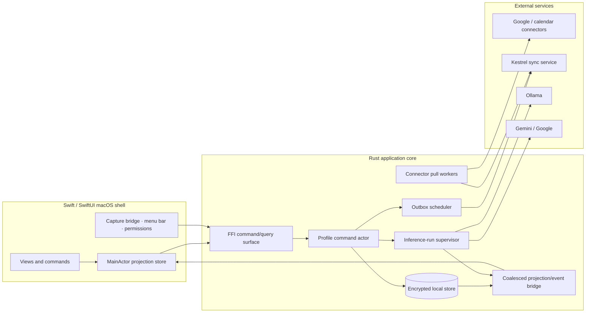

# Kestrel Rust/Swift Refactoring Blueprint

**Purpose.** This document converts the evaluation into a detailed target architecture for eliminating **intermittent sync failures** and **blocking, non-cancellable AI inference** in the existing Rust/Swift macOS app. It is designed to be adopted incrementally without a disruptive rewrite.

> **Evidence boundary.** The Kestrel source/runtime is still unavailable. Names in this document are proposed boundaries, not assertions about current modules. During the first discovery sprint, map each proposed boundary to the existing repository and retain working infrastructure rather than introducing duplicate abstractions.

## 1. Design objectives and invariants

Kestrel’s current reported pain points should be solved through a small number of non-negotiable invariants. The most important is that the desktop application becomes **locally authoritative for the user’s immediate workflow**. The network can delay replication; it may not delay saving, stopping capture, editing a note, or cancelling a model run.

| ID | Invariant | Implementation consequence |
|---|---|---|
| I-01 | Local acknowledgement precedes remote acknowledgement | A user action commits locally before any network call starts |
| I-02 | Every replicated domain effect is exactly-once, despite at-least-once transport | Domain mutation and outbox row are committed atomically; server/API uses idempotency key |
| I-03 | Capture stop and downstream processing are separate lifecycles | `StopCapture` ends inputs even if transcription, sync, or summary remains active |
| I-04 | Every inference run has one owner and one terminal state | Request ID, generation epoch, cancellation token, and run state live in Rust core |
| I-05 | Provider differences cannot alter core UI geometry | SwiftUI sees a normalized model descriptor and normalized run events only |
| I-06 | A user cancellation is authoritative in Kestrel immediately | Subsequent provider chunks are discarded once a run epoch is invalidated |
| I-07 | UI is a projection, not a parallel data store | SwiftUI dispatches typed commands and renders core snapshots/events; it does not mutate domain truth |
| I-08 | Privacy policy is enforced below the UI | A local-only meeting cannot route an input snapshot to a cloud adapter |

The target does **not** require exactly-once network delivery, which is expensive and unnecessary. It requires **at-least-once delivery with exactly-once domain effect**, made possible by stable operation IDs/idempotency keys and a durable server-side or remote-sync deduplication record.

## 2. Target component architecture

A single Rust core should own durable state transitions, background-work scheduling, and connector/provider semantics. Swift owns macOS integration and presentation: audio/device APIs when necessary, menu bar/keyboard access, accessibility, and stable window composition.



### 2.1 Proposed Rust module boundaries

Keep these as separate crates only if the current repository already favors a multi-crate workspace. A modular single crate with the same internal boundaries is acceptable. Do **not** use this refactor to introduce a new abstraction solely for aesthetics.

| Boundary | Responsibility | Explicitly excluded responsibility |
|---|---|---|
| `domain` | IDs, validated command/input types, meeting and inference state machines, policy decisions, stable event contracts | SQL, HTTP, FFI, SwiftUI detail |
| `store` | Migrations, transactions, encrypted local persistence, repositories, outbox/inbox, cursors, leases | HTTP retry and model parsing |
| `sync` | Outbox delivery, pull loops, connector state, retry classification, remote apply, conflict resolution | Displaying banners/toasts |
| `inference` | Run supervisor, capability registry, input snapshot, cancellation, stream-event normalization, retention of partial artifacts | Provider-specific request/response shape |
| `providers/*` | Ollama/Gemini/other adapter implementations, health checks, transport setup, stream parsing | Canonical UI state or business semantics |
| `capture` | Capture lifecycle contract, source health, segment boundaries, interaction with Swift/macOS audio implementation | Model/sync lifecycle |
| `bridge` | Thin FFI ABI, typed command dispatch, projection subscription, error normalization | Independent domain state |
| `diagnostics` | Structured redacted events, correlation IDs, support export, performance aggregates | Raw meeting-content logging by default |

### 2.2 One lifecycle authority per profile

Instantiate one `ProfileEngine` per signed-in/local profile. It is the only writer for user-initiated domain transitions. Internally it processes a bounded command channel; operations that need concurrency—sync, provider streaming, capture callbacks—report results back as typed engine messages rather than writing to the database independently.

```rust
// Proposed shape; adapt to the project’s existing FFI and async runtime.
pub enum CoreCommand {
    StartMeeting(StartMeeting),
    StopCapture { meeting_id: MeetingId, command_id: CommandId },
    PauseCapture { meeting_id: MeetingId, command_id: CommandId },
    ResumeCapture { meeting_id: MeetingId, command_id: CommandId },
    AppendTranscript(TranscriptChunk),
    EditNote(NoteOperation),
    RequestInference(InferenceRequest),
    CancelInference { run_id: RunId, generation: u64, command_id: CommandId },
    RetrySync { connector_id: ConnectorId, command_id: CommandId },
    ApplyRemoteDelta(RemoteDelta),
}

pub enum CoreEvent {
    Projection(CoreProjection),
    Inference(InferenceEvent),
    Sync(SyncStatus),
    Notice(UserActionableNotice),
}
```

The engine should return a command receipt with a stable `command_id` and accepted/rejected result. It must not imply that the network finished. Swift shows a local action as complete only after an authoritative projection announces the state transition.

## 3. Local data model and transaction boundaries

### 3.1 Canonical versus derived records

Kestrel needs separate records for source material, human work, derived AI output, and replication control. This prevents an AI regeneration, provider retry, or remote replay from overwriting the actual meeting record.

| Table/entity | Role | Key columns |
|---|---|---|
| `meeting_session` | Canonical meeting lifecycle | `id`, `calendar_event_id?`, `state`, `state_revision`, `started_at`, `capture_stopped_at?`, `privacy_policy`, `created_on_device` |
| `capture_segment` | Immutable capture boundary/metadata | `id`, `meeting_id`, `sequence_no`, `source`, `start_offset_ms`, `end_offset_ms?`, `content_hash`, `retention_policy` |
| `transcript_segment` | Immutable text source | `id`, `meeting_id`, `sequence_no`, `speaker/source`, `time_range`, `text`, `revision`, `hash` |
| `note_document` | User-owned note aggregate | `id`, `meeting_id`, `head_revision`, `title`, `content_snapshot?` |
| `note_operation` | Concurrent-edit operation or field revision | `op_id`, `document_id`, `actor_id`, `hlc`, `payload`, `applied_at` |
| `inference_run` | Durable lifecycle and provenance for a generation | `id`, `meeting_id?`, `model_id`, `input_hash`, `prompt_version`, `state`, `generation_epoch`, `policy_snapshot`, `started_at`, `terminal_at?` |
| `artifact` | Derived result, never canonical note truth | `id`, `run_id`, `kind`, `content`, `status`, `parent_artifact_id?` |
| `sync_outbox` | Locally committed work awaiting delivery | `operation_id`, `aggregate_type`, `aggregate_id`, `aggregate_revision`, `payload_ref`, `idempotency_key`, `state`, `attempts`, `lease_until?`, `next_attempt_at` |
| `sync_inbox` | Remote idempotency/deduplication evidence | `remote_operation_id`, `applied_at`, `payload_hash` |
| `connector_cursor` | Per-source delta progress | `connector_id`, `scope_id`, `cursor`, `last_success_at`, `last_error_class` |
| `diagnostic_event` | Redacted observable event ledger | `trace_id`, `command_id?`, `entity_ref`, `kind`, `metadata_json`, `occurred_at` |

### 3.2 Transactional outbox algorithm

All actions that create, alter, delete, or end an entity use one database transaction. There is no HTTP call within this transaction.

```text
BEGIN IMMEDIATE;
  1. Load aggregate by stable ID and verify permitted state/revision.
  2. Apply the domain state transition locally.
  3. Increment aggregate revision and write canonical/operation records.
  4. Create a sync_outbox row with operation_id + idempotency_key.
  5. Write a redacted diagnostic event that references the same trace/command.
COMMIT;
  6. Publish a coalesced updated projection.
  7. Wake the relevant outbox worker.
```

For `StopCapture`, the transaction must save `capture_stopped_at`, close the current local `capture_segment`, set meeting state to `finalizing`, enqueue `MeetingCaptureStopped`, and publish the updated state. If the app process is force-terminated before step 7, the pending outbox row is recovered on restart. If it is terminated after remote submission but before acknowledgment, the same idempotency key is redelivered safely.

### 3.3 Leases, recovery, and safe retry

Outbox rows transition `pending → leased → delivered` with a time-bounded lease. A recovered process returns expired leases to `pending` with an incremented attempt count. The worker only marks `delivered` after a remote acknowledgment that includes the submitted operation ID. A permanent failure becomes `blocked` with an error class and a user-recoverable action; a transient failure returns to `pending` with exponential backoff plus full jitter.

| Failure class | Worker behavior | User surface |
|---|---|---|
| Offline/DNS/connectivity | Hold and retry on reachability + backoff | “Saved on this Mac; will sync when online” |
| 429/rate limit | Honor retry hint where supplied; otherwise jittered backoff | No interruption unless backlog threatens a user-visible deadline |
| Remote 5xx/timeout | Retry with capped backoff; retain operation/trace | Compact “Sync delayed” only after a sustained threshold |
| Credential expired/revoked | Stop retries, mark connector `needs_auth` | “Reconnect Google” / relevant account action |
| Policy rejected | Mark operation blocked; preserve local state and explain route/policy | “This meeting is Local Only; cloud sync is disabled” or policy remedy |
| Schema/semantic conflict | Quarantine only the affected operation; do not halt queue | “Needs review” with record-specific resolver/export |

### 3.4 Pull synchronization and provider calendars

Pull workers maintain a **separate cursor per connector scope**. A pull receipt is applied transactionally with its remote operations; advance the cursor only in the same commit. If the process fails halfway through, it safely receives the same delta again and `sync_inbox` prevents duplicate application.

For calendar data, retain the provider account, calendar, provider event ID, recurrence/iCal identity, provider revision or ETag, fetch time, and visibility scope. Calendar snapshots are external facts; Kestrel meeting sessions reference them but remain separate. Cursor expiry must trigger a bounded full resync that stages/de-duplicates snapshots before changing the visible meeting list.

### 3.5 Conflict policy

Use the simplest correct conflict mechanism. Meeting capture state is a **single-author state machine**; remote writes may not reopen a locally stopped capture. Titles, tags, and settings use field-level revisions with explicit winner/conflict semantics. Rich multi-device note editing should use an operation log/CRDT only if simultaneous editing is an actual current requirement; otherwise introducing a CRDT is unnecessary complexity.

| Data type | Recommended conflict approach |
|---|---|
| Capture lifecycle | Domain transition validity and state revision; Stop is monotonic and never overwritten by stale remote state |
| Transcript segments | Immutable, sequence/time-range identity; deduplicate by segment ID + hash |
| Meeting metadata | Field-level revision with deterministic precedence and a visible resolution path for semantic conflicts |
| Note body (single-device typical case) | Operation log with optimistic revision; preserve conflicting draft for user resolution |
| Note body (true multi-device concurrency) | CRDT/operation-based merge behind a tested abstraction |
| AI artifact | Never merge automatically into human content; retain variants/provenance and let explicit apply actions update a note |

## 4. Synchronization worker design

### 4.1 Worker topology

The sync system should be composed of small supervised workers rather than one unbounded background loop.

| Worker | Trigger | Does | Must not do |
|---|---|---|---|
| `outbox_dispatcher` | Commit wake-up, reachability, next retry time | Claims due rows, groups by connector, sends idempotently | Block the Rust command actor or mutate UI state directly |
| `remote_delta_puller` | App launch, scheduled refresh, push hint, explicit refresh | Gets delta pages and applies them transactionally | Advance cursor before application is committed |
| `calendar_puller` | Calendar refresh/hint, connector reauth, explicit refresh | Fetches event deltas/snapshots and produces changes | Treat calendar content as a Kestrel-owned writable object |
| `reconciliation_worker` | Periodic, foreground resume, support action | Validates aggregate revision/backlog/cursor health | Execute destructive repair without a recoverable audit |
| `cleanup_worker` | Idle/maintenance schedule | Clears acknowledged data per retention policy, expires leases | Delete raw content without policy and verified remote acknowledgment |

Workers should communicate with the `ProfileEngine` using bounded channels. A `tokio::sync::Semaphore` or equivalent limits simultaneous connector/provider network work. Do not spawn a task per transcript segment or token. Batch logically contiguous transcript and note operations within a bounded time/size window while retaining independent idempotency keys.

### 4.2 Projection and status model

A generic global spinner hides the actual failure. Core projects an explicit status per connector plus one synthesized normal-state summary.

```rust
pub struct ConnectorHealth {
    pub connector_id: ConnectorId,
    pub state: ConnectorState, // healthy | syncing | delayed | needs_auth | blocked
    pub last_success_at: Option<DateTime<Utc>>,
    pub pending_count: u32,
    pub oldest_pending_age: Duration,
    pub actionable_error: Option<ActionableError>,
    pub trace_id: Option<TraceId>,
}
```

Swift uses this to show a quiet status dot in normal use and a source-named, action-oriented banner only when intervention is necessary. The normal meeting interface never renders retry counters, raw errors, or full queue details.

## 5. Streaming and cancellable inference

### 5.1 Provider-neutral run state

All adapters must produce the same core lifecycle regardless of whether the underlying transport is Ollama streaming, Gemini SSE, or another provider. Ollama documents streamed partial content, thinking, and tool-call fields, while Gemini’s streaming API uses typed server-sent events for interaction creation, deltas, completion, and errors. [1] [2]

```rust
pub enum InferenceRunState {
    Queued,
    Connecting,
    WarmingLocalModel,
    Streaming,
    AwaitingTool,
    Cancelling,
    Completed,
    Cancelled,
    Failed(InferenceErrorClass),
}

pub enum InferenceEventKind {
    Started,
    Progress { stage: ProgressStage, elapsed_ms: u64 },
    TextDelta { text: String },
    ThinkingDelta { summary: String },  // render only if policy permits
    ToolRequested { tool: ToolDescriptor },
    Usage { input_tokens: u64, output_tokens: u64 },
    Completed,
    Cancelled,
    Failed { class: InferenceErrorClass, retryable: bool },
}
```

Every request contains `run_id`, `generation_epoch`, `conversation_id`, a model descriptor ID, privacy-policy snapshot, and an immutable input snapshot reference/hash. On retry or model change, increment the epoch. The client renders events only if both run ID and current epoch match, eliminating late-chunk corruption.

### 5.2 Adapter trait

The adapter contract must not return a monolithic final string. It accepts a cancellation token and emits normalized events. The exact async and FFI syntax should match the existing codebase.

```rust
#[async_trait]
pub trait ModelAdapter: Send + Sync {
    fn descriptor(&self) -> ModelDescriptor;

    async fn health(&self) -> ProviderHealth;

    async fn run(
        &self,
        request: ProviderRequest,
        cancel: CancellationToken,
        sink: Arc<dyn InferenceEventSink>,
    ) -> Result<ProviderTerminal, ProviderError>;
}
```

The supervisor creates the cancellation token and registers it by `run_id`. The adapter uses `select!`-style cancellation during connection, body-read, tool wait, and response parsing. It closes/aborts its client request or response stream promptly on cancellation. The supervisor writes the terminal `cancelled` state durably, invalidates the generation epoch, and emits a projection before awaiting cleanup. Any later received provider data is dropped without reaching storage or Swift.

### 5.3 Lifecycle sequence

```mermaid
sequenceDiagram
  participant S as SwiftUI
  participant C as Rust Core
  participant D as Local Store
  participant A as Provider Adapter
  participant P as Model Provider

  S->>C: RequestInference(input, model, policy)
  C->>D: Persist InferenceRun(Queued, input hash, epoch)
  C-->>S: Projection: Connecting
  C->>A: run(request, cancellation token)
  A->>P: Stream request
  P-->>A: Connected / first delta
  A-->>C: Started / TextDelta events
  C-->>S: Coalesced streaming events
  S->>C: CancelInference(runId, epoch)
  C->>D: Mark Cancelling; invalidate current epoch
  C-->>S: Projection: Cancelling
  C->>A: cancel token
  A-->>P: Abort/close transport
  C->>D: Mark Cancelled; persist partial artifact by policy
  C-->>S: Projection: Cancelled; keep/discard partial
  P-->>A: Late chunk (if any)
  A-->>C: Late delta
  C-->>C: Drop: invalid run epoch
```

### 5.4 Persistence and UI update cadence

Never perform a durable transaction for every token. Accumulate partial output in memory and checkpoint it to the `artifact` record at a bounded cadence—e.g., every 250 ms or 256 characters, plus all terminal states—subject to device profiling. UI events are coalesced to the main actor no more frequently than the screen can usefully render (for example, frame-bounded), but the displayed text remains append-only while the user has not cancelled.

| Condition | Core behavior | Swift behavior |
|---|---|---|
| Connection begins | Persist run, allocate cancel token, emit `Connecting` | Show state and active Stop immediately; editor remains enabled |
| Local model cold-start | Emit `WarmingLocalModel` heartbeat with elapsed time and model name | “Loading local model · 00:14”; never imply Kestrel froze |
| Text delta | Buffer, checkpoint at cadence, publish coalesced delta | Append to dedicated response cell without moving focus |
| User cancel | Invalidate epoch, cancel transport, durable `Cancelling → Cancelled` | Transition to Stopping immediately; no more deltas render |
| Provider fails | Classify error and durable terminal state; leave prompt/input intact | Explain exact next action: Retry, change model, or review provider health |
| App exits | Cancel non-resumable transport; mark run interrupted/cancelled as policy requires | On relaunch show a coherent terminal state, never a fake live spinner |

### 5.5 Cancellation semantics

Promise only what Kestrel controls: after a cancellation is accepted, Kestrel prevents further output from appearing and closes its client-side stream promptly. A remote or local provider may take provider-specific time to release compute after client disconnect; instrument this behavior separately and expose a health/error state if it becomes operationally harmful. Do not hard-code an assumption that all Ollama versions can be force-killed by a generic API command.

### 5.6 Capability registry and policy enforcement

The Google-model overlap should be solved at this core layer, not in SwiftUI. A model is described by data; the UI receives only the fields necessary to select and explain it.

```rust
pub struct ModelDescriptor {
    pub id: ModelId,
    pub provider: ProviderId,
    pub display_name: String,
    pub location: ModelLocation,          // local | approved_cloud | cloud
    pub supports_streaming: bool,
    pub supports_tools: bool,
    pub supports_thinking: bool,
    pub context_window: u32,
    pub policy_tags: Vec<PolicyTag>,
    pub availability: ModelAvailability,
}
```

Before dispatch, the Rust core evaluates `MeetingPrivacyPolicy × ModelDescriptor × EnterprisePolicy`. A denied request never reaches an adapter. The Swift picker shows only allowed choices and clearly labels their location, but UI filtering is not the security control.

## 6. Swift bridge and presentation refactor

### 6.1 Typed bridge principles

Use the current Rust/Swift bridge if it can support asynchronous commands, typed projection updates, and cancellation. If it cannot, introduce a thin generated/binding layer rather than serializing untyped JSON through view code. The bridge exposes only stable DTOs and command methods.

```swift
// Proposed presentation shape; adapt syntax to the existing bridge.
@MainActor
@Observable
final class MeetingWorkspaceModel {
    private let core: KestrelCoreClient
    private var eventTask: Task<Void, Never>?

    var projection: MeetingProjection
    var inference: [RunID: InferenceRunProjection] = [:]

    func start() {
        eventTask = Task {
            for await event in core.events() {
                guard !Task.isCancelled else { return }
                apply(event) // updates only MainActor presentation state
            }
        }
    }

    func stopCapture() async {
        _ = try? await core.stopCapture(meetingID: projection.id)
        // The following projection, not optimistic local mutation, is authoritative.
    }

    func cancel(run: InferenceRunProjection) async {
        _ = try? await core.cancelInference(id: run.id, generation: run.generation)
    }
}
```

SwiftUI actions must never await a long-running provider/sync task. They send a command, preserve keyboard focus, and let the event stream move the UI through `Connecting`, `Streaming`, `Cancelling`, `Cancelled`, `Failed`, or `Completed`.

### 6.2 Event coalescing and backpressure

The bridge must distinguish **durable domain projections** from **high-frequency ephemeral deltas**. It should use a bounded channel and coalesce replaceable events such as elapsed time, audio levels, provider progress, and text deltas. It must not drop terminal transitions, capture boundaries, user edits, or error events.

| Event class | Delivery policy | Reason |
|---|---|---|
| Meeting lifecycle, Stop, permission/device failure | Never coalesce/drop; ordered | Safety and durable truth |
| Note/edit projection | Revisioned; latest projection after atomic commit | Avoid stale render without flooding |
| Transcript segment | Ordered, batched within small bounded interval | Retain all content with usable UI cadence |
| Inference text delta | Append/coalesce per run and epoch | Avoid main-thread churn while preserving sequence |
| Audio meters, elapsed time, retries | Latest-only at a bounded rate | The next value supersedes prior visual state |
| Diagnostics | Write to local ledger; UI fetches on demand | Avoid exposing sensitive/internal data in normal flow |

### 6.3 No direct provider/sync calls from views

Remove provider-specific `Task { await … }` work from SwiftUI views and view models. A common failure pattern is having each model button own its own client, loading state, and error presentation. It creates inconsistent cancellation and allows model additions to modify unrelated layout. All `Ollama`, `Gemini`, and future provider logic must be behind the core adapter registry; Swift receives one model picker and one run projection contract.

## 7. Recording boundary integration

The recording refactor is a prerequisite for trustworthy sync. Model finalization cannot keep a microphone session visually live.

| Command | Domain effect | Outbox effect | Presentation effect |
|---|---|---|---|
| `StartMeeting` | Create meeting and first capture segment; state `capturing` after capture acknowledgement | Enqueue meeting upsert | Show active indicator only after capture is confirmed |
| `PauseCapture` | Close current active source interval; state `paused` | Enqueue lifecycle event | Paused text/icon; no false active waveform |
| `StopCapture` | Close input boundary and set `finalizing` | Enqueue stop + final segment state | Within target latency show “Recording stopped; finalizing” |
| `TranscriptFinalized` | Append immutable segment(s) | Enqueue segment operations | Update transcript without stealing note focus |
| `RequestSummary` | Create independent `inference_run` | Artifact sync only when policy permits | AI state is separate from capture state |

This separation enables an immediate Stop even if a local model is warming, a cloud provider is offline, or an outbox backlog exists.

## 8. Migration and rollout plan

Avoid a “big bang” replacement of sync. Introduce new controls in shadow/feature-flag mode, validate records, and then switch user-visible behavior.

| Phase | Change | Compatibility/rollback |
|---|---|---|
| 0 — Discovery | Map current Rust crates, Swift bridge, store/migrations, network flows, capture ownership, provider adapters, and existing telemetry | Produce a code-location decision record; no behavior change |
| 1 — Additive schema | Add state revision, `inference_run`, `artifact` provenance, outbox/inbox/cursor/diagnostic tables and indexes | All new tables are additive; old sync remains authoritative |
| 2 — Command authority | Route Start/Stop/Edit/Inference request through one core command interface while retaining existing UI projections | Feature flag per command; compare old/new result locally |
| 3 — Shadow outbox | Write outbox rows transactionally but do not send from new dispatcher; reconcile against existing sync logs | Disable dispatcher to roll back; no data loss from additive rows |
| 4 — New sync dispatcher | Enable per connector/profile; retain old path read-only or disable by connector after reconciliation | Lease expiry + idempotency makes restart/rollback safe |
| 5 — Streaming adapters | Add normalized streaming/cancel path behind provider-specific flags; first stream to diagnostics/UI preview | Fallback to old completion path only while correctness is proven |
| 6 — New Swift projections | Replace provider-specific view state with event-driven workspace model; use snapshot tests before rollout | Feature flag new workspace shell; retain compatible commands |
| 7 — Enforce policy and cleanup | Enforce local-only dispatch boundary, retire old queues/state, schedule retention cleanup | Remove only after migration/account-health verification |

### Migration safeguards

Every migration must be reversible where practical, idempotent, and tested on an encrypted local-store copy. Provide an in-app progress/recovery state instead of blocking the user on application launch. Before retiring old records, verify aggregate counts, revision ranges, outbox/inbox reconciliation, and a sampled content-hash match. Preserve a backup/export path compatible with the user’s retention policy.

## 9. Test strategy

### 9.1 Deterministic Rust tests

| Test category | Required scenarios |
|---|---|
| State-machine unit tests | All legal/illegal meeting and inference transitions; duplicate Start/Stop/Cancel idempotency |
| Transaction tests | Inject failure before/after each outbox write; confirm atomic local aggregate/outbox state |
| Property tests | Arbitrary repeated/reordered outbox operations converge to one domain effect |
| Fake connector tests | Cursor expiry, duplicate inbound delta, remote reorder, 429, timeout, token revocation, malformed payload |
| Fake provider stream tests | Connect delay, first-token delay, token sequence, tool step, error, cancellation at every stage, late delta after cancel |
| Concurrency/race tests | Cancel then retry; model switch while streaming; Stop capture while inference streams; app shutdown with leased operation |
| Policy tests | Local-only and enterprise-restricted context never invoke a cloud adapter |

### 9.2 Swift/macOS integration tests

| Test | Pass condition |
|---|---|
| Focus stability | Type continuously in notes while transcript and AI deltas arrive; cursor and accessibility focus do not move |
| Stop accessibility | Window, menu-bar, and keyboard Stop all invoke one core command; UI immediately shows `finalizing` |
| Slow Ollama | Warming/progress appears without freezing the note editor; Cancel path stays reachable |
| Sync recovery | Disable/re-enable network after Stop/Edit; local meeting remains visible and syncs exactly once on recovery |
| Provider growth | 10+ descriptors with long names / unavailable state render through the same picker without changing window geometry |
| Force-termination | Terminate after command commit, during sync lease, during delta stream, and during finalization; relaunch finds a coherent local state |

### 9.3 Performance and observability metrics

Emit redacted, correlation-linked metrics; never put transcript text, prompts, tokens, or credential material into general logs.

| Metric | Use |
|---|---|
| `command_accept_ms` by command | Confirm Stop and edits are not blocked by network/model work |
| `outbox_oldest_age`, pending count, leases expired, delivery attempts | Detect sync stalls before data loss/support escalation |
| `sync_apply_dedupe_count`, cursor reset count, remote conflict count | Detect idempotency/cursor regressions |
| `inference_time_to_started_ms`, `time_to_first_delta_ms`, delta rate | Separate provider latency from UI rendering delay |
| `inference_cancel_to_ui_ms`, `cancel_to_transport_closed_ms`, late delta count | Prove cancellation agency and find adapter problems |
| `ui_event_queue_depth`, coalesced/dropped ephemeral event count | Detect bridge backpressure without risking durable events |
| `capture_stop_accept_ms`, finalization age | Separate user stop responsiveness from background completion |

## 10. Definition of done

The refactor is complete only when the following are demonstrated in a repeatable test build, not merely observed manually.

1. A local edit, meeting start/stop, transcript segment, and user-visible note survive forced termination before and after network submission.
2. Replaying the same outbox batch multiple times yields no duplicate meeting, transcript segment, task, or deletion.
3. Each user-visible sync problem identifies its connector, last successful operation, safe local status, and immediate recovery action.
4. Ollama and Gemini responses render incrementally through the same `InferenceEvent` contract, and the model picker does not create model-specific layout surfaces.
5. Cancelling a run invalidates its epoch, closes Kestrel’s client transport, sets a durable terminal state, and prevents later output from rendering.
6. Stop recording moves Kestrel to `finalizing`/`idle` inside the agreed interaction budget even if inference and sync are unavailable.
7. No SwiftUI view retains independent provider/sync state that can conflict with the Rust projection.
8. The support diagnostic export provides correlation without exposing raw transcript content by default.

## References

[1]: https://docs.ollama.com/capabilities/streaming "Ollama — Streaming"
[2]: https://ai.google.dev/gemini-api/docs/streaming "Google AI for Developers — Streaming interactions"
[3]: https://docs.granola.ai/help-center/taking-notes/transcription "Granola — How transcription works"
