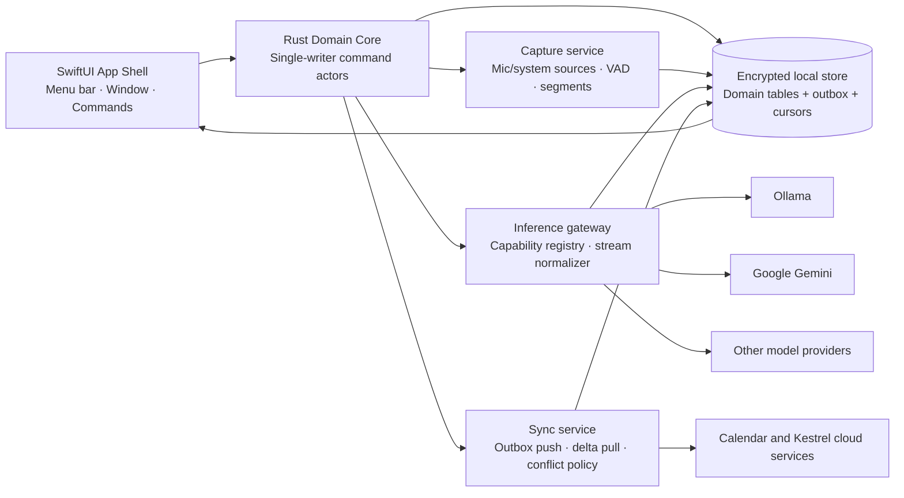

# Kestrel macOS Architecture Assessment — Evidence-Based Draft

**Scope.** This assessment covers the existing Rust/Swift macOS app only. The selected repository was `futuremeanswered/CareerPointers`, which contains no Rust/Swift macOS source; no Kestrel folder was bound. Accordingly, all statements about Kestrel’s implementation are either **reported observations** from the brief or **recommended target-state architecture**, not code-verified defects.

## Evidence classification

| ID | Observation | Evidence | Confidence | Consequence |
|---|---|---|---|---|
| R-01 | Intermittent synchronization failures | User report | High | Trust loss, duplicate or absent meeting context, hidden data risk |
| R-02 | The interface wastes space | User report | High | Slower scanning and a less composed macOS experience |
| R-03 | UI overlaps after Google models were added | User report | High | Potentially unusable model and inference controls; regression in layout resilience |
| R-04 | LLM inference cannot be stopped or streamed | User report | High | Long-running work feels frozen; especially poor for local models |
| R-05 | Ollama can be slow | User report | High | An opaque wait appears as app failure without progress, cancellation, and recovery |
| U-01 | Current persistence schema, sync protocol, and conflict policy | Source unavailable | Unknown | Must be verified before modifying migrations or sync behavior |
| U-02 | Current audio-capture and lifecycle implementation | Source unavailable | Unknown | Must be verified before modifying permissions, app audio, or meeting boundaries |

## Architecture diagnosis

The reported symptoms are consistent with a product that lacks clear boundaries between **local user intent**, **durable domain state**, **background synchronization**, and **provider work**. A blocking inference path can stall presentation; a model-specific interface can force a fixed layout to overflow; and a sync process that is not an idempotent, durable state machine will produce intermittent user-visible inconsistency. These are architectural product problems, not isolated defects.

Kestrel should become deliberately **local-first**. The macOS app should commit a user action locally in a short transaction, immediately reflect that action in the interface, and let independent background services replicate calendar, note, transcript, and derived-material changes. A network timeout, model stall, or calendar-provider failure must never block recording controls or invalidate a locally completed note.



## Data architecture: target model

Kestrel should distinguish **source facts**, **user-authored content**, **derived AI artifacts**, and **replication metadata**. Treating AI summaries or rendered note blocks as canonical data creates avoidable corruption, reprocessing ambiguity, and conflict problems. Keep immutable source content (calendar snapshot, transcript segments, capture metadata) independently addressable; write user changes as document operations or field-level revisions; and mark every model output with an input-content hash, prompt/template version, provider/model, and generation status.

| Data class | Canonical record | Required identity/versioning | Sync and retention recommendation |
|---|---|---|---|
| Calendar source | `calendar_event_snapshot` | Provider account + calendar + provider event ID; iCalUID/recurrence metadata; ETag and provider update timestamp | Provider-delta sync; retain latest usable snapshot plus provenance; do not invent a second calendar truth |
| Meeting | `meeting_session` | UUIDv7/ULID; calendar-event foreign key nullable; explicit start/stop timestamps and lifecycle revision | Sync as a durable primary domain entity; local session exists before network acknowledgment |
| Capture/transcript | `capture_segment`, `transcript_segment` | Immutable segment ID; session ID; sequence number; sample/time range; source (mic/system); content hash | Sync transcript chunks idempotently; default raw-audio policy must be explicit and separately consented |
| Notes | `note_document`, `note_operation` | Stable document ID; operation ID; actor/device ID; hybrid logical clock | CRDT for concurrent rich-text edits; otherwise field-level optimistic revisions with a visible conflict resolver |
| AI output | `artifact`, `inference_run` | Run ID; input hash; prompt/template version; model/provider; run state; parent artifact | Derived and replaceable; preserve provenance; never silently overwrite a human edit |
| Sync control plane | `sync_operation`, `sync_cursor`, `sync_error` | Operation UUID; idempotency key; domain aggregate revision; per-connector cursor | Persisted outbox/inbox, acknowledged deletion only, retry class, diagnostic trace ID |

The highest-value decision is to make the **outbox transactional with the local domain mutation**. For example, “stop meeting” must update `meeting_session` to `finalizing`, enqueue `MeetingStopped`, persist the final capture boundary, and update the UI in one local transaction. If the process crashes before upload, the outbox guarantees recovery. The sync service then sends operations with stable idempotency keys, accepts acknowledgments only after durable server processing, and pulls remote deltas using a cursor. This prevents the common failure mode of a mutation appearing complete in the UI but vanishing or duplicating after restart.

## Synchronization architecture: target behavior

Kestrel has at least two synchronization categories that require different contracts: **provider synchronization** (for example, Google Calendar) and **Kestrel data replication** (meetings, transcripts, notes, AI artifacts). They should have separate queues, cursors, status surfaces, and retry policies. Combining them into one generic “Sync” state hides what is broken and makes recovery unsafe.

| Concern | Resolution | User-visible behavior | Acceptance criterion |
|---|---|---|---|
| Local writes | Command actor writes domain mutation + outbox event atomically | New meeting/note is usable immediately, even offline | Kill app after each local mutation; no acknowledged user action is lost after relaunch |
| Push replication | Bounded batches, idempotency keys, exponential backoff with full jitter, retry classification | Background; only a durable failure becomes a compact actionable banner | Replaying any queued batch 10 times creates no duplicate meeting, transcript, or task |
| Pull replication | Cursor-based deltas, watermark stored only after transaction commits; full-resync fallback | “Updated just now” is associated with a named source, not a vague spinner | Crash between receive and commit yields no skipped remote change |
| Conflicts | CRDT for note text; deterministic field-level policy for metadata; manual resolver only for true semantic conflict | Preserve both edits and explain the outcome | Concurrent offline title/tag edits converge consistently on two devices |
| Calendar events | Provider sync token, ETag/update version, recurring-event identity, de-duplication on provider account/calendar/event key | Per-account state and “last successful update” exposed in Settings | Provider cursor expiry triggers safe bounded full resync without duplicate meeting cards |
| Error recovery | Persist failure reason, correlation ID, retry count and next retry time; circuit-break broken credentials | Plain-language “Reconnect Google” or “Retry now” actions | Token revocation, offline mode, 429, 5xx, and schema failure are distinguishable and recoverable |
| Observability | Trace local mutation → outbox → server ack → pull confirmation; metrics for backlog age and duplicate suppression | Diagnostic export for support, with redaction by default | Engineering can identify failure class from an ID without requiring a user to reproduce it |

Granola provides a useful user-facing minimum: it bounds the upcoming-meeting surface, describes expected propagation time, allows calendar choice, documents duplicates, and identifies a related-meeting strategy. [1] Kestrel should surpass this by making the actual **health of every source, queue, and recovery action inspectable**, without putting operational clutter in the normal meeting flow.

## Recording state machine and meeting boundaries

Recording must not be modeled as a single Boolean. Kestrel should use a persisted, idempotent finite-state machine with command ownership in the Rust core and a read-only projection to SwiftUI. It must treat capture stop and AI processing as separate operations: a user who presses Stop has stopped capture even if transcription finalization or summarization continues.

| State | Entry events | Permitted actions | Required UI contract |
|---|---|---|---|
| `idle` | Launch, completed, dismissed failure | Start ad-hoc, open calendar meeting | Quiet start affordance; no misleading active indicator |
| `armed` | User opens eligible meeting | Start, cancel | Clear session title/source; consent and device readiness visible |
| `capturing` | Successful start acknowledgment from capture worker | Pause, stop, mark moment | Persistent elapsed time, live levels, source health, prominent Stop |
| `paused` | Explicit pause or temporary audio interruption | Resume, stop | Unambiguous paused state; elapsed and transcript boundary shown |
| `finalizing` | Explicit stop, deterministic auto-stop, sleep handling | Open note, discard pending derived jobs, retry processing | “Recording stopped” arrives immediately; AI status cannot masquerade as recording |
| `complete` | Transcript/notes ready or intentionally deferred | Resume to a new segment, regenerate, edit | Provenance and completion state are visible; no forced wait |
| `failed` | Permission, device, disk, provider, or internal failure | Retry, choose source, export diagnostics | Specific reason and safe recovery; never claim recording when capture failed |

The app should provide a **single canonical Stop command** accessible from the note, a macOS menu-bar status item, and a keyboard command. The action must synchronously issue `StopCapture(session_id, command_id)` to the command owner, return an accepted state transition within a small deterministic budget, cancel only capture work, flush the segment boundary, and be safely repeatable. Automatic stop can assist but cannot be trusted as the primary boundary mechanism; Granola explicitly documents the failure cases of administrator restrictions and back-to-back meetings, and positions manual stop as the reliable override. [2]

Kestrel should have better safeguards: warn before merging a new calendar event into an active session, show a compact banner when expected end time passes, and require an explicit “Continue this meeting” versus “Start new meeting” choice after a detected meeting transition. Granola’s in-note activity indicator, floating indicator, transcript visibility, stop/resume, chunk control, and search form a strong interaction baseline. [2]

## Provider-neutral AI inference architecture

The provider list must be data, not layout. Define a versioned `ModelDescriptor`/capability registry in the Rust core, then render the same fixed interaction contract for every provider. Model metadata should describe context limit, modality, streaming support, tool support, thinking visibility policy, local/remote location, availability, and known warm-up expectations. UI only receives a stable view model.

```text
InferenceRequest { request_id, conversation_id, model_id, input_ref, generation_epoch }
InferenceEvent   { request_id, kind: Started|Delta|Progress|Tool|Usage|Completed|Failed|Cancelled }
Cancellation     { request_id, generation_epoch, source: User|Superseded|Shutdown }
```

The gateway should normalize SSE, chunked HTTP, and local streaming into these events. It must own a cancellation token and close the underlying request/response body when the user stops work. The UI must immediately transition to `Stopping…` while retaining already-rendered output; after a short cancellation grace period it marks the run `Cancelled`, retains a “Keep partial” option, and rejects any subsequent provider chunk whose request ID or generation epoch is no longer current. This prevents the late-output race that often corrupts a new answer after a model switch or retry.

Ollama’s REST API supports streaming by default, and its streaming contract emits partial content and, for suitable models, thinking and tool-call fields. [3] Gemini supports streaming response deltas over server-sent events with explicit created, status, delta, completion, and error events. [4] The inability to stream or stop is therefore a Kestrel integration gap, not an unavoidable provider limitation. The exact abort call must be verified in the existing Rust HTTP implementation, but the design requires a per-run cancellation primitive, connection/body teardown, and UI state decoupled from network completion.

| Inference experience | Current reported condition | Required resolution | Testable quality bar |
|---|---|---|---|
| First feedback | Appears blocking, especially with Ollama | Emit `Started`, connection/model-load progress, and streamed deltas into a single stable response cell | User sees an immediate in-flight state and first meaningful text as soon as provider supplies it |
| Stop | Cannot stop | Persistent Stop; core cancellation; HTTP/SSE closure; late-event suppression | Stop is usable in every in-flight state and no new text appears after confirmed cancellation |
| Slow local model | Slow wait with no control | Cold-start/warm-up phase, model-loading indicator, elapsed time, model size/context display, queued/retry actions | A 60-second cold start reads as intentional work rather than application failure |
| Provider differences | Google models created overlap | Capability-driven selector contained in a popover/sheet, not a growing toolbar | Adding 50 descriptors does not change base window geometry or overlap controls |
| Partial result | All-or-nothing response | Append-only streamed draft, explicit completion/cancel/failure terminal state, optional keep/discard partial | Failed/cancelled generations never overwrite a completed message or human note |
| Context safety | Undefined | Build input snapshot from immutable references; display source references; enforce token budget before dispatch | Same run can be reproduced with its input hash and prompt version |

## Critical code-validation checklist

Before changes are merged, inspect the actual Rust/Swift project for the following rather than assuming any are absent:

1. The app’s current database engine, migrations, encryption, and transaction boundary for an action plus its replication event.
2. Whether an outbox/inbox and durable connector cursors already exist; if so, identify their idempotency and crash-recovery behavior.
3. Google Calendar auth scopes, incremental-sync mechanism, ETag use, duplicate-event key, recurrence strategy, and token-expiry recovery.
4. The capture implementation, audio-device ownership, permissions, persistence policy, sleep/app-termination behavior, and current start/stop state transitions.
5. The Rust/Swift concurrency boundary: thread/actor ownership, main-thread UI updates, task cancellation propagation, and backpressure limits.
6. Each model adapter’s stream flag, transport, cancellation method, token/delta parsing, timeout policy, and model metadata source.
7. Constraints/layout code at every supported minimum window width, Dynamic Type/Accessibility text size, localization expansion, and all model-selector populations.
8. Tests and telemetry for retry, duplicate suppression, cancellation race, capture boundary, and visual regression.

## Initial implementation order

The order should privilege restoring trust: first decouple capture Stop from all downstream work; next normalize and cancel inference; then make sync durable and inspectable; finally redesign the content hierarchy and provider selection. The visual redesign must not be deferred until after capability growth, because the Google-model overlap shows the current layout does not safely scale.

| Priority | Workstream | Why now | Definition of done |
|---|---|---|---|
| P0 | Stop recording/inference and prevent stale output | Prevents user loss of control and meeting-boundary corruption | State-machine tests; cancel-race tests; menu-bar/note/shortcut Stop all use the same command |
| P0 | Layout containment and regression suite | Current overlap can obstruct core controls | Fixed base hierarchy, adaptive constraints, visual snapshots across widths/text sizes/model counts |
| P0 | Sync forensics and durable retry | Intermittent loss/duplication destroys product trust | User-visible source health; idempotent outbox; diagnostics; critical failure scenarios exercised |
| P1 | Streaming inference and local-model progress | Converts perceived freeze into understandable, interruptible work | Provider-neutral event adapter and first-token/progress instrumentation |
| P1 | Canonical data model and provenance | Enables dependable recall, re-generation, and future multi-device support | Migrations, provenance fields, data-policy specification, export/deletion flows |
| P2 | Contextual prep and work memory | Closes the functional gap to Granola/Littlebird after the trust layer is solid | Grounded meeting brief, linked history, and cited answers with user control |

## Sources

[1] Granola, “Syncing your calendars.” https://docs.granola.ai/help-center/getting-started/syncing-your-calendars

[2] Granola, “How transcription works.” https://docs.granola.ai/help-center/taking-notes/transcription

[3] Ollama, “Streaming.” https://docs.ollama.com/capabilities/streaming

[4] Google AI for Developers, “Streaming interactions.” https://ai.google.dev/gemini-api/docs/streaming

[5] Apple, “Layout — Human Interface Guidelines.” https://developer.apple.com/design/human-interface-guidelines/layout

[6] Littlebird, “AI Meeting Notes, Bot-Free.” https://littlebird.ai/features/meeting-notes

[7] Littlebird, “Privacy Policy.” https://littlebird.ai/privacy-policy
